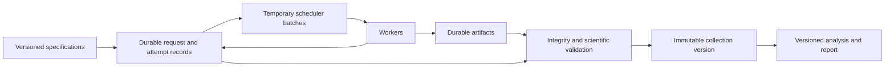

# Reproducible asynchronous computation

Preserve calculation identities, attempt provenance, artifacts, and collection versions independently of temporary execution batches.

Use this design when calculations exceed an interactive session or require repeated distributed submissions.
It is a proposed engineering pattern, not a requirement from DVC or a provenance standard.
Its foundations include [PROV-DM](https://www.w3.org/TR/prov-dm/) and [AiiDA](https://doi.org/10.1038/s41597-020-00638-4).

## Assign identities before execution

| Object | Identity and contents |
| --- | --- |
| Calculation specification | Immutable method, input hashes, resolved parameters, environment, seed, and replicate identity |
| Request | Durable intent to execute a specification, including requester and collection membership |
| Attempt | Unique execution identity, specification reference, timestamps, actual environment, status, and artifact references |
| Artifact | Content hash, byte length, format, durable location, and producing attempt |
| Collection version | Immutable member list, expected population, selection policy, exclusions, and status summary |
| Batch | Temporary scheduler grouping with references to requests or attempts |

A content digest can identify a calculation specification.
Define canonical serialization before computing that digest.
Resolve default parameter values and record the schema version.
Keep storage locations separate from content identity where possible.

Include every setting that can affect scientific output.
Record actual hardware and runtime settings on the attempt even when the specification permits several environments.
Exclude queue names and scheduler identifiers from scientific identity unless they affect the method.

Create a new attempt for a retry.
Create a new specification when inputs, scientific parameters, or relevant environment requirements change.
Represent independent stochastic replicates explicitly.
Never count a retry or cache reuse as an independent replicate.
For cache reuse, link the reuse record to the original producing attempt and artifact hashes.

## Keep the durable stores small and explicit



Git can hold specifications and small collection manifests.
DVC can preserve artifact snapshots and execute analysis stages.
A database or append-only record store can hold concurrent requests, attempts, and status events.
The scheduler handles resource allocation and job execution.

Export provenance in an open format and include those exports in backups.
Retain old schema versions or provide explicit migrations.
Preserve corrections as new records that reference the original records.
Do not make a live dashboard the only copy of the scientific history.

An existing workflow engine can supply much of this behavior.
Evaluate its provenance, retry, checkpoint, and export capabilities before building custom infrastructure.

## Make submission and completion recoverable

1. Write the request to durable storage before sending it to the scheduler.
2. Use a stable request identifier to reconcile uncertain submission outcomes.
3. Create an attempt record before scientific execution starts.
4. Write outputs into an attempt-specific location.
5. Upload artifacts and verify their hashes and required structure.
6. Publish an immutable result manifest through a conditional write or transaction.
7. Evaluate scientific acceptance and record the result separately.
8. Acknowledge completion only after durable publication succeeds.

The reconciler checks outstanding requests against attempt records, scheduler state, and result manifests.
After an agent session ends, a later session retrieves outstanding work through durable request identifiers.
After a connection failure, it checks for existing work before submitting another attempt.
If execution repeats, conditional publication prevents duplicate acceptance.
Enforce acceptance uniqueness for each requested calculation, including its replicate identity.
Preserve conflicting outputs for inspection instead of silently selecting the last writer.

Kubernetes explicitly documents possible duplicate execution, including Jobs that request a single completion. [Job failure handling](https://kubernetes.io/docs/concepts/workloads/controllers/job/#handling-pod-and-container-failures).
Design for repeated execution and idempotent publication.
Do not claim exactly-once computation.

## Keep execution status separate from scientific acceptance

| Status dimension | Example values |
| --- | --- |
| Execution | pending, running, succeeded, failed, cancelled, unknown |
| Artifact publication | absent, partial, verified |
| Scientific acceptance | pending, accepted, rejected, inconclusive |

A missing heartbeat does not prove failure.
A zero exit code does not prove complete output.
A verified file does not prove convergence or biological relevance.

Record failures, cancellation reasons, and diagnostic summaries durably.
Stream essential logs to durable storage during execution.
An upload only at completion cannot preserve logs when a worker disappears.
Preserve the information needed to distinguish infrastructure failures from method failures.
Apply retry limits and record any changed resource allocation.
Define how the system handles late results after cancellation.
If a retry changes numerical behavior, preserve that difference in the specification or its explicit execution policy.

## Freeze collections before analysis

Define the expected population before submission when possible.
For adaptive research, version each expansion and record its selection rule.

A collection manifest identifies exact member artifacts and their producing attempts.
It also records missing, failed, excluded, and unresolved members.
Preserve the selection query and its resolved member list.
A query such as "all successful results" can change over time.

Fix membership order when ordering affects downstream analysis.
Choose duplicate-resolution rules before inspecting results.
Never silently replace a member because a later attempt produces a more favorable score.

For example, a collection expects 100 calculations.
Its manifest can record 96 accepted results, three failures, and one unresolved attempt.
An analysis can use that snapshot if its stated policy permits partial coverage.
The report must show the denominator and missingness.
A later completion creates a new collection version.

This illustrative manifest summarizes selected fields:

```yaml
schema_version: 1
collection_id: example-analysis
version: 1
expected_members_manifest: expected-members.json
selection_policy: selection-policy.yaml
members_manifest: resolved-members.json
status_counts:
  expected: 100
  accepted: 96
  failed: 3
  unresolved: 1
```

The real record also needs hashes for each referenced manifest and policy.
Each resolved member needs its specification, attempt, artifact hash, and durable location.
The example does not define a complete interoperable schema.
The example counts describe an invented scenario.

## Connect asynchronous results to DVC

Use one of these integration boundaries:

| Boundary | Contract |
| --- | --- |
| Blocking workflow stage | The command returns success only after outputs exist and validation passes. |
| Separate asynchronous service | Submission returns a request ID. Later analysis consumes a finalized collection snapshot. |

A stage that only submits a job produces a submission receipt.
Do not interpret that receipt as the scientific result.
DVC executes stage commands and tracks their declared outputs. [DVC reproduction](https://dvc.org/doc/command-reference/repro).

For long workloads, prefer the separate service boundary when interactive sessions can disappear.
Track the finalized collection manifest and materialized artifacts as analysis dependencies.
Make retrieval verify content hashes.
Prevent analysis from reading a changing directory while workers continue writing into it.

Keep the executable specification for expensive computation even when the normal report workflow restores its results.
Document separate commands for restoration, analysis, and deliberate recomputation.
Use isolated workspaces for concurrent runs.

## Retain enough state to resume and audit

Checkpoint expensive calculations when the method supports restart.
Preserve the checkpoint hash, parent attempt, progress position, and relevant algorithm state.
Include random generator, optimizer, or sampler state when restart depends on it.
Test restart on representative work.
Document whether restart preserves exact execution or only the accepted numerical behavior.

Keep checkpoints and scratch directories while recovery needs them.
Nextflow requires both task-cache records and corresponding work outputs for normal resume behavior. [Nextflow caching and resuming](https://docs.seqera.io/nextflow/cache-and-resume).

After durable publication and recovery checks, delete temporary batches and eligible scratch data.
Retain input snapshots, result artifacts, validation records, and required provenance.
Preserve batch membership when joint computation makes that membership scientifically meaningful.

## Verify the design with failures

Before using the design for expensive research, check these cases:

- The submitter loses its connection after the scheduler accepts a request.
- A worker restarts and produces a duplicate result.
- Upload succeeds, but the completion acknowledgment fails.
- A worker produces partial output or fails scientific validation.
- One collection member remains missing.
- The scheduler deletes its job records.

For each case, verify that the scientific history remains inspectable and the reconciler avoids silent loss or duplicate acceptance.
